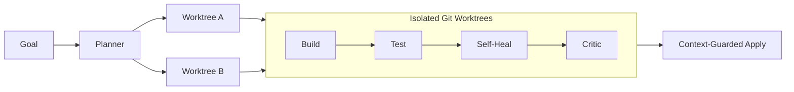

# OutrCore Open Swarm

[](LICENSE)
[](https://www.python.org/)
[](macos/OpenSwarmApp.swift)

**Repository:** [`github.com/outrcore/open-swarm`](https://github.com/outrcore/open-swarm)

An Apple-clean, agent-first native macOS desktop app and zero-dependency Python engine for dispatching parallel coding swarms in isolated git worktrees.

---

## Highlights

- **Zero-dependency Python stdlib engine** (no pip bloat) + lightweight native macOS Swift/WebKit shell (`Open Swarm.app`)
- **Parallel Git Worktree Isolation** + deterministic **Shared KV Prefix Caching** + **AST Repo Symbol Indexing**
- **Autonomous Self-Healing Loop** — workers automatically inspect failing test output and repair patches before surfacing diffs
- **Blind Tournament Mode & Critic Review** — multi-stance worktrees, automatic test disqualification, author-independent diff critic, and blind judge
- **Built-in SQLite Continuity & Context Guard** — SHA-256 pre-apply guard against external edits, action journal, and advisory agent blackboard
- **BYO OpenAI-Compatible Backend** — OutrCore Cloud (`https://api.outrcore.com/v1`), local `k5cuda` / `vLLM` / `Ollama`, or custom `~/.open_swarm/presets.json` / `OPEN_SWARM_BACKEND_URL`

---

## Architecture



---

## Quickstart

### 1. Build the Native macOS App

Requires macOS 13+ with Xcode Command Line Tools (`swiftc`).

```bash
bash macos/build_app.sh
open "dist/Open Swarm.app"
```

To build, verify code signing, and package a distributable macOS release archive (`dist/OpenSwarm-macOS.zip`):

```bash
bash macos/release.sh
```

### 2. Run the HTTP / Web UI Directly

Run directly from source with the Python standard library (binds to `127.0.0.1` by default):

```bash
python3 desktop_server.py --port 18790
```

Or install in editable mode and launch via the CLI entry point:

```bash
pip install -e .
open-swarm
```

Then open [http://127.0.0.1:18790](http://127.0.0.1:18790) in your browser.

---

## Configuration

Configure your OpenAI-compatible inference backend via environment variables or a local presets file:

| Setting | Description | Example |
| --- | --- | --- |
| `OPEN_SWARM_BACKEND_URL` | Base URL for an OpenAI-compatible `/v1` endpoint | `https://api.outrcore.com/v1` |
| `OPEN_SWARM_MODEL` | Default model identifier to dispatch to swarm workers | `ornith-ai/Ornith-1.5-35B-A3B` |
| `~/.open_swarm/presets.json` | User-defined backend & model presets loaded by the UI | See example below |

Example `~/.open_swarm/presets.json`:

```json
[
  {
    "id": "outrcore_cloud",
    "label": "OutrCore Cloud API",
    "backend_url": "https://api.outrcore.com/v1",
    "model": "ornith-ai/Ornith-1.5-35B-A3B"
  },
  {
    "id": "local_vllm",
    "label": "Local vLLM / k5cuda",
    "backend_url": "http://127.0.0.1:8000/v1",
    "model": "your-local-model"
  }
]
```

Additional optional environment variables:

- `OPEN_SWARM_STATE_DIR` — Override the local state/runs directory (defaults to `~/.open_swarm/runs`).
- `OPEN_SWARM_DEFAULT_REPO` — Default git repository path pre-selected in the desktop UI.

---

## Running Tests

Run the offline unit test suite (no external network calls required):

```bash
python3 -m unittest discover -s tests -v
```

---

## License

MIT License — see [LICENSE](LICENSE).
