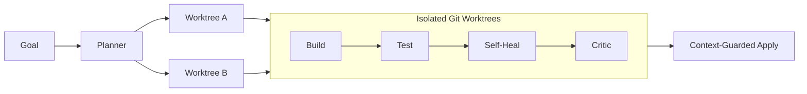

# OutrCore Open Swarm

[](LICENSE)
[](https://www.python.org/)
[](macos/OpenSwarmApp.swift)

**Repository:** [`github.com/outrcore/open-swarm`](https://github.com/outrcore/open-swarm)

An Apple-clean, agent-first native macOS desktop app and zero-dependency Python engine for dispatching parallel coding swarms in isolated git worktrees.

---

## Highlights (`v0.4.0`)

- **Zero-dependency Python stdlib engine** (no pip bloat) + lightweight native macOS Swift/WebKit shell (`Open Swarm.app`)
- **Swarm Message Board & Atomic File Leases** — live coordinator-hosted SQLite/SSE message board (`CLAIM_FILE`, `CONTRACT`, `FINDING`, `QUESTION`, `NEED_DECISION`, `BLOCKED`, `DONE`, `DECISION`), per-agent cursors, atomic file-ownership leases, and human decision replies in UI
- **Hardened Multi-Turn Agent Tool Loop (M1)** — OS-sandboxed `run_command` (macOS Seatbelt `sandbox-exec` / Linux `bwrap`), automatic regex secret scrubbing, `list_dir`, `git_diff`, surgical `edit_file` with closest-match line hints, instant syntax diagnostics (`py_compile` / `json` / `node --check`), background PTY/tmux command handles, `write_note`, and shared board/lease tools
- **DAG Wave Orchestrator & Tool-Enabled Critic Gate** — dependency-ordered execution waves (`depends_on` / contract-first phases), read-only critic inspection across untouched callers/tests, test-quality rubric, automated critic-repair loop, `Cross-Vendor Verified` vs `Same-Vendor Fresh` badges, and **Post-Merge Integration Test Gate** before touching `main`
- **Security Hardening** — `Host`/`Origin`/`X-OpenSwarm-CSRF` loopback protection, scoped ephemeral coordinator LLM proxy tokens so remote workers never receive raw upstream keys, and forced `core.hooksPath=/dev/null` on all git worktree/bundle operations
- **Verified Devices & Live Compute Mesh (Tailscale)** — live `gpu_util_pct` / VRAM / free-RAM telemetry, busy-GPU routing guard, async remote jobs with SSE log streaming, incremental bare-repo mirror delta sync, and 6-digit PIN + SHA-256 fingerprint pinning
- **Karpathy Autoresearch Swarm (M2)** — multi-island git worktree evolution with `.open_swarm/{program.md,results.tsv,findings.md}`, **strictly isolated `eval_cmd` vs untimed `health_cmd` unit tests**, SHA-256 tamper protection, monotonic git ratchet, and live SVG Score Sparkline
- **BYO OpenAI-Compatible Backend** — OutrCore Cloud (`https://api.outrcore.com/v1`), local `k5cuda` / `vLLM` / `Ollama`, or custom `~/.open_swarm/presets.json` / `OPEN_SWARM_BACKEND_URL`

---

## Architecture



---

## Quickstart

### 1. Build the Native macOS App

Requires macOS 13+ with Xcode Command Line Tools (`swiftc`).

```bash
bash macos/build_app.sh
open "dist/Open Swarm.app"
```

To build, verify code signing, and package a distributable macOS release archive (`dist/OpenSwarm-macOS.zip`):

```bash
bash macos/release.sh
```

### 2. Run the HTTP / Web UI Directly

Run directly from source with the Python standard library (binds to `127.0.0.1` by default):

```bash
python3 desktop_server.py --port 18790
```

Or install in editable mode and launch via the CLI entry point:

```bash
pip install -e .
open-swarm
```

Then open [http://127.0.0.1:18790](http://127.0.0.1:18790) in your browser.

---

## Configuration

Configure your OpenAI-compatible inference backend via environment variables or a local presets file:

| Setting | Description | Example |
| --- | --- | --- |
| `OPEN_SWARM_BACKEND_URL` | Base URL for an OpenAI-compatible `/v1` endpoint | `https://api.outrcore.com/v1` |
| `OPEN_SWARM_MODEL` | Default model identifier to dispatch to swarm workers | `ornith-ai/Ornith-1.5-35B-A3B` |
| `~/.open_swarm/presets.json` | User-defined backend & model presets loaded by the UI | See example below |

Example `~/.open_swarm/presets.json`:

```json
[
  {
    "id": "outrcore_cloud",
    "label": "OutrCore Cloud API",
    "backend_url": "https://api.outrcore.com/v1",
    "model": "ornith-ai/Ornith-1.5-35B-A3B"
  },
  {
    "id": "local_vllm",
    "label": "Local vLLM / k5cuda",
    "backend_url": "http://127.0.0.1:8000/v1",
    "model": "your-local-model"
  }
]
```

Additional optional environment variables:

- `OPEN_SWARM_STATE_DIR` — Override the local state/runs directory (defaults to `~/.open_swarm/runs`).
- `OPEN_SWARM_DEFAULT_REPO` — Default git repository path pre-selected in the desktop UI.

---

## Use OutrCore Cloud (`api.outrcore.com`) with Open Swarm & BYOK Coding Agents

Point any OpenAI-compatible coding agent at `https://api.outrcore.com/v1` to leverage persistent KV prefix caching across agent turns:

- **Open Swarm:** Built-in Preset #1 (`OutrCore Cloud`).
- **Cline / Roo Code:** Provider = `OpenAI Compatible`, Base URL = `https://api.outrcore.com/v1`, Model = `thinkingmachines/Inkling-2-Mini`.
- **Continue (`~/.continue/config.yaml`):** `provider: openai`, `apiBase: https://api.outrcore.com/v1`, `model: thinkingmachines/Inkling-2-Mini`.
- **Aider:**
  ```bash
  export OPENAI_API_BASE=https://api.outrcore.com/v1
  export OPENAI_API_KEY=<your-key>
  aider --model openai/thinkingmachines/Inkling-2-Mini
  ```

---

## Verified Devices & Compute Mesh (Tailscale)

Pair secondary workstations (such as a Linux GPU server or DGX Spark) over Tailscale with zero open public ports:

```bash
python3 swarm_node.py --pair
```

Open Swarm detects online Tailscale peers, verifies each machine with a single-use 6-digit code and SHA-256 fingerprint pinning, and automatically routes macOS/Swift work locally while dispatching GPU/CUDA tasks and overflow worktrees onto paired Linux GPU nodes.

---

## Running Tests

Run the offline unit test suite (no external network calls required):

```bash
python3 -m unittest discover -s tests -v
```

---

## License

MIT License — see [LICENSE](LICENSE).
